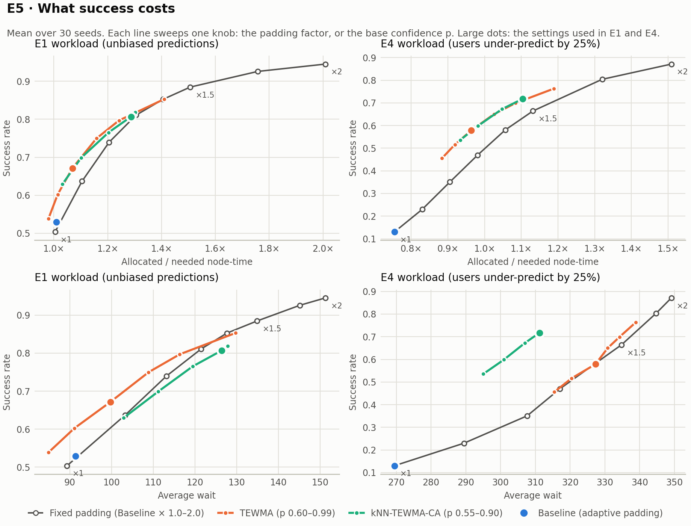
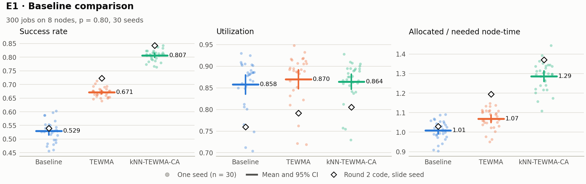
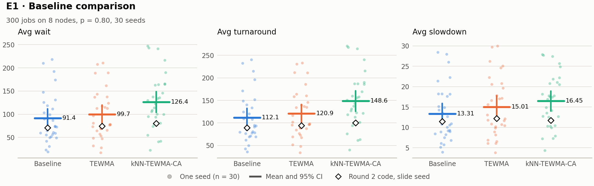
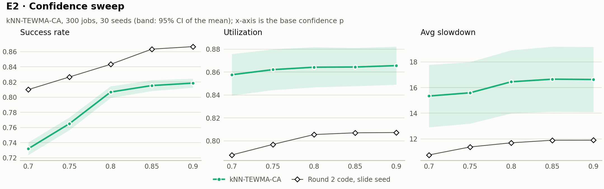
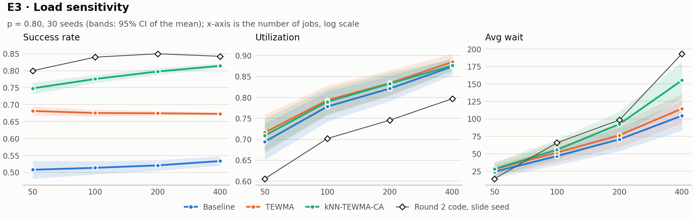
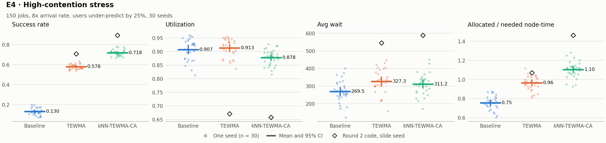
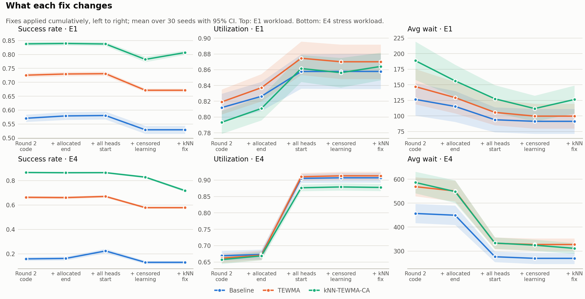

# kNN-TEWMA-CA

**A contention-aware adaptive scheduler for HPC job backfilling**

Hi, I'm Neeraj, a master's student in Computer Science at the University of Kansas. This is my research project for EECS 700 (Algorithms for HPC). It's a backfilling scheduler that learns how wrong users' runtime estimates tend to be and uses that to make safer backfill decisions, plus the event-driven cluster simulator I built to test it against an EASY-style baseline and a TEWMA-only scheduler.

This repo is a cleaned-up rebuild of the code behind my Round 2 presentation. It still reproduces the presentation numbers exactly. The main results fix six problems in the Round 2 code and in how it evaluated the schedulers, and the new numbers are shown next to the originals.

## Results at a glance

| Claim | Round 2 slides (one seed) | Now (corrected, 30 seeds, mean [95% CI]) |
|:--|:--|:--|
| Success rate, kNN-TEWMA-CA vs baseline | 0.540 → 0.843 (+56.2%) | 0.529 → 0.807 (+53.1% [+49.1, +57.2]), better on 30/30 seeds |
| Utilization, kNN-TEWMA-CA vs baseline | 0.760 → 0.805 (+6.0%) | 0.858 → 0.864 (+0.9% [−0.1, +1.9]), no significant difference |
| Avg wait, kNN-TEWMA-CA vs baseline | 70.7 → 80.4 (+13.8%) | 91.4 → 126.4 (+45.8% [+36.1, +55.6]), longer on every seed |
| Stress-test success, kNN-TEWMA-CA vs TEWMA | 0.707 → 0.893 (+26.4%) | 0.578 → 0.718 (+24.1% [+22.4, +25.8]), better on 30/30 seeds |
| Allocated / needed node-time (Baseline / TEWMA / kNN-TEWMA-CA) | not reported | 1.01× / 1.07× / 1.29× |
| Reservation violations | 0, reported as a result | 0 by construction, for all three schedulers |

Relative changes in the right-hand column are averaged per seed, so they don't always equal the ratio of the two means.

The short version: kNN-TEWMA-CA still kills far fewer jobs than the other two, on every seed, but part of that comes from reserving more time. So a new experiment (E5) compares every scheduler with a baseline that simply pads all allocations by a fixed factor.

- **Per unit of reserved capacity,** both learned schedulers beat fixed padding: by a few points of success on the normal workload and about 9–14 points under stress.
- **Per unit of queue time, the picture splits.** Under stress kNN-TEWMA-CA is far ahead: it reaches the same success as fixed padding or TEWMA with about 25 time units less waiting, at the cost of about 3 points of utilization. On the normal workload it waits longer than either for the same success, and plain TEWMA is the more efficient choice.

The utilization gain from my slides doesn't hold up.



## The problem

On an HPC cluster, users submit jobs with a node count and a runtime estimate, and the scheduler decides what runs when. Most production schedulers use some form of **EASY backfilling**:

1. Jobs wait in first-come, first-served order.
2. If the job at the head of the queue doesn't fit, it gets a **reservation**: the earliest time enough nodes will be free.
3. Smaller jobs further back may **backfill** (jump ahead) if they fit on the idle nodes now and will finish before that reservation.

Backfilling only works if runtime estimates are good, and they usually aren't. If the scheduler trusts an estimate that's too low, the job is killed when it hits its time limit. If the estimate is too high, nodes sit idle and backfill opportunities are lost. So the question this project asks is:

> How can backfilling stay safe and efficient when runtime predictions are uncertain?

## How kNN-TEWMA-CA works

The name lists the three pieces: **kNN** runtime refinement, **TEWMA** (trust-based exponentially weighted moving average) runtime correction, and **C**ontention **A**wareness.

### 1. TEWMA runtime correction

Jobs are bucketed by predicted runtime $\hat p$ into short (< 10), medium (10–50) and long (≥ 50) classes, and each class learns from its own finished jobs. For each finished job the relative error is

$$e = \frac{\hat p - \text{actual}}{\text{actual}} \qquad (e > 0: \text{over-predicted},\ e < 0: \text{under-predicted})$$

Each class keeps an exponentially weighted bias $b$ and variance $v$ of $e$. The smoothing factor adapts to how volatile recent errors are: $\alpha = \text{clip}(0.1 + 0.25\,\sigma_{20} / 0.5,\ 0.1,\ 0.6)$, where $\sigma_{20}$ is the spread of the last 20 errors. Noisy classes adapt quickly and stable ones smooth more.

The runtime the scheduler allocates at confidence level $c$ removes the bias and adds a safety margin of $z_c$ standard deviations:

$$r_{\text{TEWMA}} = \max\!\Big(0.9\,\hat p,\ \ \frac{\hat p}{\max(0.1,\ 1 + b)}\cdot m_c\Big), \qquad m_c = \max\big(0.5,\ 1 + z_c\sqrt{v}\big)$$

Each class also gets a **trust score** $\max(0,\ 1 - |b| - 0.5\sqrt{v})$. Until a class has seen three jobs, it allocates $1.25\,\hat p$ and its trust is a neutral 0.5. $\alpha$ starts at 0.3 and only adapts once four errors are in.

**Learning from killed jobs.** A job that hits its allocation is killed, so the scheduler never finds out how long it would have run, only that it needed more. That's a censored observation: its error is only known to be below $e_c = \hat p / \text{allocated} - 1$. Pretending the job ran exactly its allocation would teach the model that jobs are shorter than they are. Instead, the model takes its current $N(b, v)$ as the error distribution, with $\sigma$ floored at 0.1, and learns from the expected error given $-0.95 < e < e_c$. The lower limit assumes a job runs at most 20× its prediction. It also adds that conditional distribution's own variance. This is the mean and variance of a truncated normal, which amounts to one online EM step. The reconstructed runtime also goes into the kNN history.

### 2. kNN refinement

TEWMA corrects a whole class at once. The kNN step looks at the jobs most similar to this one: from the class's last 100 finished jobs it takes the $k = 8$ with the closest predictions in log space, $d = |\log(\hat p / \hat p_i)|$, so a 2-to-20 gap counts the same as 20-to-200. It averages their actual/predicted ratios $\rho_i$ with weights $1/(d + 0.001)$ (100 for an exact match). That local ratio replaces TEWMA's class-wide bias correction, and TEWMA's safety margin stays:

$$r_{\text{kNN}} = \text{clip}\big(\hat p \cdot \bar\rho \cdot m_c,\ \ 0.6\,\hat p,\ \ \min(\rho_{\max}, 5)\,\hat p\big)$$

$\rho_{\max}$ is a per-class cap. It starts at 3, jumps to any newly observed ratio plus 10% headroom, and otherwise decays 1% per job so a single outlier doesn't set it forever. Until a class has 8 jobs of history, the kNN step is skipped and the TEWMA estimate is used as is.

### 3. Contention awareness

Queue pressure $P \in [0, 1]$ is an EMA of how much node-time the queue is asking for, relative to what the free nodes could deliver over one typical job length. Pressure changes three things:

* **Confidence goes up:** $c = \min(0.95,\ c_0 + 0.15P)$. A congested queue gets more conservative allocations.
* **The backfill window shrinks:** only the first $w(P)$ of the time until the reservation is open to backfill, with $w = 1$ for $P \le 0.2$ and $1 - 0.3P^{1.2}$ above that (0.7 at full pressure).
* **Low-trust classes are gated out:** a class needs trust ≥ $0.2P$ for its jobs to backfill.

A backfill candidate has to fit on the free nodes now, end inside the window, and have an estimate of at least $0.85\,\hat p$. Candidates are ranked by

$$\text{score} = \frac{1}{r + 1}\cdot\frac{1}{\text{nodes} + 0.5}\cdot \text{trust}^{1.5}$$

so short, narrow, well-predicted jobs go first, and they are launched greedily while nodes remain.

### The comparison schedulers

* **Baseline (EASY-style):** the head job gets exactly its predicted runtime. Backfill candidates are padded by 1.0×, 1.2× or 1.5× depending on the average prediction error of the last 50 jobs, and backfilled in queue order. It reconstructs killed jobs' runtimes with the same estimator as the other two, so none of them gets an edge from how it handles censoring.
* **TEWMA:** piece 1 only. Every allocation is $r_{\text{TEWMA}}$, and candidates are ranked by estimate × nodes × trust.
* **Fixed padding (E5 only):** the baseline with every allocation multiplied by a constant factor. It's a reference point for how much success plain over-allocation buys.

## The simulator

* **Cluster:** 8 identical nodes. A job runs for `min(allocated, actual)` runtime. If its allocation is too short it is killed at the limit and counts as a failure, like a walltime kill.
* **Dispatch:** at every event (arrival or completion), jobs at the head of the queue start while they fit. The first one that doesn't fit gets a reservation, and then backfilling runs.
* **What schedulers can see:** each job's prediction and node count; for running jobs, their start time and allocation; and for finished jobs, how long they ran and whether they were killed. They never see a job's true runtime. Reservations are planned from allocated end times, the way production backfill planners such as SLURM's work.
* **Workload:** Poisson arrivals (λ = 0.15 jobs per time unit). 60% short jobs (actual runtime uniform on 1–10), 30% medium (10–50), 10% long (50–200), each asking for 1–4 nodes. Predicted runtime = max(1, actual × (1 + ε)) with ε ~ N(bias, σ), where σ is 0.2 / 0.4 / 0.6 for short / medium / long.
* **Load:** at λ = 0.15 the cluster receives about 1.16× the work it can process, so the queue keeps growing. That's deliberate: it keeps backfilling busy, and it's why waits grow with the number of jobs.
* **Metrics:** makespan, average wait (start − submit), average turnaround (finish − submit), success rate (jobs not killed), utilization (busy node-time / (makespan × nodes)), average slowdown (turnaround / max(actual, 1)), and allocated / needed node-time (Σ allocated × nodes / Σ actual × nodes: how much capacity a scheduler reserves relative to what jobs needed).

## Experiments

Every chart below shows the corrected, 30-seed results. In the strip charts each faint dot is one seed, the bar is the mean with its 95% confidence interval, and the ◇ is the Round 2 code's value on the slide seed. In the line charts the band is the 95% CI of the mean. The full tables are in [`results/corrected.md`](results/corrected.md).

### E1 · Baseline comparison

300 jobs, 8 nodes, base confidence p = 0.80.





| Metric | Baseline | TEWMA | kNN-TEWMA-CA |
|:--|--:|--:|--:|
| Success rate | 0.529 ± 0.038 | 0.671 ± 0.017 | **0.807 ± 0.021** |
| Utilization | 0.858 ± 0.060 | **0.870 ± 0.058** | 0.864 ± 0.047 |
| Avg wait | **91.4 ± 53.5** | 99.7 ± 53.5 | 126.4 ± 59.9 |
| Avg slowdown | **13.31 ± 6.79** | 15.01 ± 7.34 | 16.45 ± 6.60 |
| Allocated / needed node-time | 1.01 ± 0.05 | 1.07 ± 0.05 | 1.29 ± 0.07 |

The success ranking is solid: kNN-TEWMA-CA beats both other schedulers on all 30 seeds. The allocation row explains part of it, since it reserves 29% more node-time than jobs need, against 7% for TEWMA. Utilization is now about the same for all three (0.858–0.870), and kNN-TEWMA-CA's differences from the other two are within noise. The extra allocation comes out of the queue instead: about 35 time units more average wait than the baseline (95% CI 29.1–40.9), and longer on every seed.

### E2 · Confidence sweep

kNN-TEWMA-CA at p ∈ {0.70, 0.75, 0.80, 0.85, 0.90}.



Success climbs from 0.732 at p = 0.70 to 0.807 at p = 0.80, then flattens (0.815, 0.819), and allocated node-time flattens with it (1.15× → 1.29× → 1.30×). Queue pressure stays high in this overloaded workload, so the pressure-adjusted confidence often sits at its 0.95 ceiling. That happens about half the time at p = 0.80 and about 90% of the time from p = 0.85, so raising p further changes little. p = 0.80 is still a sensible default. It's where the sweep stops paying off.

### E3 · Load sensitivity

50, 100, 200 and 400 jobs at p = 0.80. In the slides this experiment only ran kNN-TEWMA-CA; here all three schedulers run on the same workloads so there's a reference point.



kNN-TEWMA-CA's success rate rises with job count (0.75 at 50 jobs to 0.81 at 400), as its classes collect more history. The baseline rises slightly (0.51 to 0.53) and TEWMA stays flat (≈ 0.67–0.68). Waits grow with job count for everyone, because the cluster is overloaded, and kNN-TEWMA-CA's grows fastest (155.3 at 400 jobs vs 104.6 for the baseline).

### E4 · High-contention stress

150 jobs at 8× the arrival rate (λ = 1.2), with users under-predicting by 25% on average (bias −0.25, noise × 0.8).



| Metric | Baseline | TEWMA | kNN-TEWMA-CA | CA − TEWMA [95% CI] |
|:--|--:|--:|--:|--:|
| Success rate | 0.130 ± 0.035 | 0.578 ± 0.025 | **0.718 ± 0.030** | +0.139 [+0.130, +0.148] |
| Utilization | 0.907 ± 0.039 | **0.913 ± 0.034** | 0.878 ± 0.029 | −0.035 [−0.043, −0.028] |
| Avg wait | **269.5 ± 62.6** | 327.3 ± 68.1 | 311.2 ± 60.7 | −16.1 [−26.6, −5.5] |
| Avg slowdown | 39.66 ± 8.68 | 50.18 ± 10.98 | **38.83 ± 7.93** | −11.35 [−13.98, −8.71] |
| Allocated / needed node-time | 0.75 ± 0.07 | 0.96 ± 0.08 | 1.10 ± 0.08 | +0.14 [+0.12, +0.15] |

kNN-TEWMA-CA completes 14 percentage points more jobs than TEWMA (better on all 30 seeds), with a slightly shorter wait and clearly lower slowdown. The price is utilization, about 3.5 points lower. The baseline has the shortest queue, but it collapses to 13% success because it allocates exactly what the under-predicting users asked for; its error-based padding never kicks in here. Success under stress is lower than in my slides (0.718 vs 0.893). Most of that drop comes from the kNN fix: the Round 2 version corrected the users' bias twice, so it happened to over-allocate exactly when users under-predicted.

### E5 · What success costs (new)

Success can always be bought with longer allocations, so the fair question is what each scheduler pays for its success. E5 sweeps each scheduler's knob on both workloads: the baseline's padding factor (1.0× to 2.0×), and the base confidence p for TEWMA and kNN-TEWMA-CA. The chart at the top of this README plots success against two costs: reserved capacity (allocated / needed node-time, top row) and average wait (bottom row). Settings near the default operating points:

| E1 workload | Allocated / needed node-time | Success | Utilization | Avg wait |
|:--|--:|--:|--:|--:|
| Fixed padding × 1.2 | 1.21 | 0.740 | 0.877 | 113.2 |
| Fixed padding × 1.3 | 1.31 | 0.811 | 0.882 | 121.5 |
| TEWMA, p = 0.95 | 1.24 | 0.797 | 0.879 | 116.3 |
| kNN-TEWMA-CA, p = 0.80 | 1.29 | 0.807 | 0.864 | 126.4 |

| E4 workload | Allocated / needed node-time | Success | Utilization | Avg wait |
|:--|--:|--:|--:|--:|
| Fixed padding × 1.5 | 1.13 | 0.664 | 0.907 | 334.8 |
| Fixed padding × 1.75 | 1.32 | 0.804 | 0.908 | 344.8 |
| TEWMA, p = 0.95 | 1.08 | 0.699 | 0.908 | 334.2 |
| kNN-TEWMA-CA, p = 0.80 | 1.10 | 0.718 | 0.878 | 311.2 |

The comparisons below interpolate along each sweep in the full tables.

* **Reserved capacity:** both learned schedulers get more success than fixed padding for the same node-time. On the normal workload the gap is about 6–9 points at low allocation and shrinks to 0–4 points at the higher allocations around the operating points. Under stress it's about 9–14 points.
* **Queue time, normal workload:** for the same success as kNN-TEWMA-CA (0.807), fixed padding waits about 5 time units less and TEWMA about 8 less, with higher utilization. Here TEWMA alone is the better scheduler.
* **Queue time, under stress:** kNN-TEWMA-CA reaches 0.718 success at an average wait of 311. Fixed padding needs about 339 and TEWMA about 336 for the same success; at a wait of 311, fixed padding only reaches about 0.40. Its utilization is about 3 points lower.
* **No tuning:** the learned schedulers pick their padding themselves. A fixed factor has to be re-tuned per workload: matching kNN-TEWMA-CA's success takes about 1.3× on the normal workload but about 1.6× under stress. A fixed 1.3× drops to 0.469 success under stress.

## What changed since Round 2

The rebuild fixes six problems. `knn-tewma-ca reproduce` still runs the original code paths, and the tests pin the slide numbers exactly.

1. **Reservations only use information a real scheduler has.** The original code planned each reservation from running jobs' *true* finish times. Reservations now use start time plus allocated runtime.
2. **Zero reservation violations is a guarantee, not a result.** Every backfilled job gets an allocation that ends by the head job's reservation, and it's killed if it runs past that, so it always hands its nodes back in time. Backfilling can't delay a reservation under any of the three schedulers. The simulator re-checks this after every backfill round and raises `ReservationGuaranteeError` if it ever fails. The tests check that no reserved job ever starts after the time it was promised, and that a deliberately broken scheduler that ignores the window is caught (`tests/test_reservation_guarantee.py`).
3. **Thirty seeds instead of one.** Every number in the presentation came from a single random workload (seed 42 for E1/E2, 99 for E3, 7 for E4). Each experiment now runs on 30 workloads (seeds 0–29), with every scheduler on the same workloads. The tables report mean ± standard deviation and paired 95% confidence intervals, and I count on how many seeds kNN-TEWMA-CA beats each of the other two.
4. **Killed jobs no longer reveal their true runtime.** The Round 2 schedulers learned from the real runtime of jobs they had killed, which no real scheduler can see. Schedulers now get an `Observation`, how long the job ran and whether it was killed, and reconstruct censored runtimes as described above.
5. **Every head job that fits starts right away.** The Round 2 event loop started at most one job from the head of the queue per event, and skipped backfilling at any event where it started one. Everything else waited for the next arrival or completion.
6. **kNN no longer corrects the bias twice.** The Round 2 kNN step multiplied its ratio onto a TEWMA estimate that had already removed the class bias. Under systematic under-prediction that corrected the same bias twice: in E4 it reserved 1.44× the node-time jobs needed, against 1.10× now.



The chart applies the fixes one at a time, over the same 30 seeds. (Fixes 2 and 3 don't have a step of their own: 2 changes no numbers, and every step already uses 30 seeds.)

* **Fix 5 (head jobs) moves utilization and waits the most.** Utilization rises 3–5 points on the normal workload and 21–24 under stress, and waits fall by about 18% and 40%. It barely changes success.
* **Fix 4 (censored learning) costs success.** Every scheduler loses 5–6 points on the normal workload, and up to 9 under stress.
* **Fix 6 (kNN) cuts both ways for kNN-TEWMA-CA.** It raises normal-workload success by 2.5 points, at the cost of about 13% more waiting. Under stress it brings over-allocation down from 1.26× to 1.10× of needed node-time, at the cost of 11 points of success.

The step-by-step tables are in [`results/comparison.md`](results/comparison.md).

## What's still on my list

* **Make the contention-aware part pay off on normal workloads too.** E5 says its advantage over TEWMA shows up under stress, and on the normal workload it costs queue time. Next I want to try node count as a second kNN dimension and per-user histories, and to look at which of the pressure controls (confidence boost, window, gate, score) actually earns its keep.
* **Better learning under censoring.** The reconstruction assumes normally distributed relative errors. A non-parametric estimator such as Kaplan–Meier on the actual/predicted ratio might adapt better to biased users.
* **Scope:** synthetic workloads instead of real traces, a small 8-node cluster, nodes as the only resource, no per-user fairness, and several hand-picked parameters.

Further out, I'd like to validate on real traces (ANL Intrepid, LLNL logs), try it as a SLURM backfill plugin, replace the hand-tuned pressure curves with a learned (reinforcement learning) policy, and extend it to mixed CPU/GPU nodes.

## Running it

Requires Python 3.9+ and matplotlib.

```bash
git clone https://github.com/neerajydv0908/kNN-TEWMA-CA.git
cd kNN-TEWMA-CA
python3 -m venv .venv && source .venv/bin/activate
pip install -e ".[dev]"

knn-tewma-ca              # everything: reproduce, corrected E1-E5, ablation, reports and charts
knn-tewma-ca reproduce    # just the Round 2 numbers (a few seconds)
knn-tewma-ca corrected --seeds 50 --workers 4 --out results-50
pytest                    # 116 tests
```

The full run takes a couple of minutes and uses one worker process per CPU (up to 8) by default. Without installing, `PYTHONPATH=src python3 -m knn_tewma_ca` runs the same thing from the repo root.

| Output | What's in it |
|:--|:--|
| `results/reproduce.md` | The Round 2 tables, reproduced exactly |
| `results/corrected.md` | Main results: 30 seeds, mean ± std, paired comparisons, E5 tables |
| `results/comparison.md` | Slides vs corrected, plus the fix-by-fix ablation tables |
| `results/runs.csv` | Every simulation run (mode, experiment, scheduler, workload, seed, swept parameter x, metrics); written by `all` and `corrected` |
| `results/figures/` | Charts for the corrected results, plus `reproduce_*.png` redraws of the presentation charts |

Using the scheduler directly:

```python
from knn_tewma_ca import DEFAULT_WORKLOAD, KnnTewmaCA, generate_jobs

jobs = generate_jobs(DEFAULT_WORKLOAD, total_nodes=8, seed=0)
result = KnnTewmaCA(total_nodes=8, confidence=0.80).run(jobs)
print(result.metrics)
```

Pass `methodology=ROUND2` (also exported by the package) to any scheduler to run the original Round 2 behaviour.

## Repository layout

```
src/knn_tewma_ca/
  job.py           job model and runtime classes
  workload.py      synthetic workload generator (seeded, no global random state)
  predictors.py    per-class TEWMA + kNN model, censored-runtime reconstruction, queue pressure
  simulator.py     event loop, what schedulers may observe, reservations and the guarantee check
  schedulers.py    Baseline, TEWMA, kNN-TEWMA-CA and the fixed-padding reference
  metrics.py       scheduling metrics
  experiments.py   E1-E5, the ablation, and the reproduce / corrected modes
  stats.py         means, confidence intervals, paired comparisons
  report.py        markdown and CSV reports
  plotting.py      charts
  cli.py           the knn-tewma-ca command
tests/             unit tests, including exact reproduction of the slides
results/           generated reports and charts
```

## License

[MIT](LICENSE) © 2026 Neeraj Yadav
